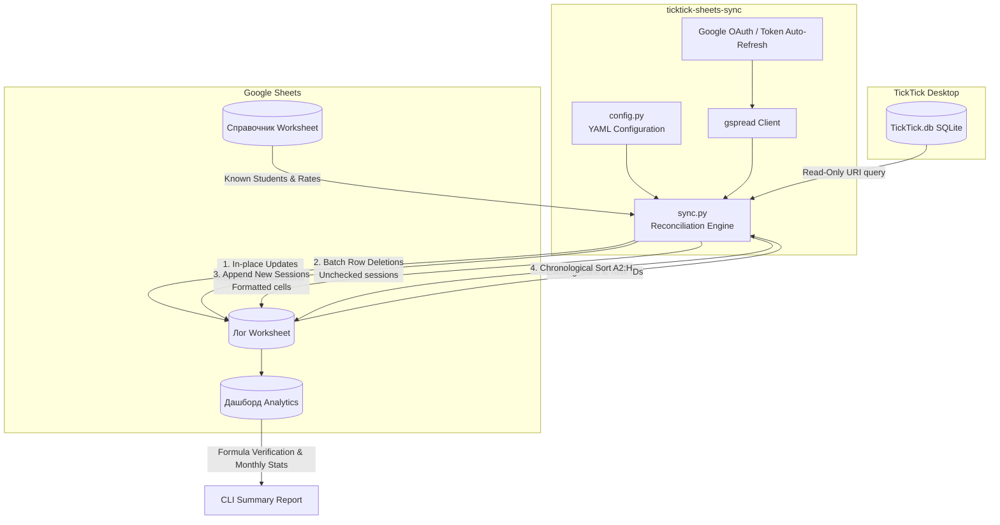

# 📚 TickTick to Google Sheets Sync Engine

[](https://www.python.org/)
[](https://developers.google.com/sheets/api)
[](https://www.sqlite.org/)
[](https://docs.microsoft.com/windows/win32/taskschd/)
[](https://opensource.org/licenses/MIT)

> **Automated two-way state reconciliation and analytics engine connecting TickTick desktop task manager with Google Sheets financial dashboards.**

[English](#overview) | [Русский](#обзор-проекта)

---

## Overview

**TickTick to Google Sheets Sync Engine** bridges personal task management and business analytics. Designed primarily for private tutors, consultants, and freelancers, it extracts completed sessions directly from the local TickTick desktop SQLite database, applies a robust **State Reconciliation algorithm**, updates Google Sheets in atomic batches, and validates monthly revenue formulas.

### 🌟 Key Architectural Features

1. **⚡ TickTick SQLite Reverse Engineering (`mode=ro`)**  
   Direct read-only access to TickTick's desktop SQLite database (`TickTick.db`). Bypasses cloud API rate throttling, works completely offline, and reads sub-second task state without locking the desktop application.

2. **🔄 Two-Way State Reconciliation Engine**  
   - **Cancellation / Uncheck**: If a task previously marked complete is unchecked or deleted in TickTick, the engine detects its absence and automatically removes the corresponding row from Google Sheets (`[ОТМЕНА]`).
   - **Reschedule / Duration Updates**: If a session's date, time, duration, or student name changes in TickTick, the row in Google Sheets is updated in-place (`[ПЕРЕНОС]`).
   - **Atomic Appends**: New sessions are appended at the bottom with native date/time and duration cell formatting.
   - **Chronological Sorting**: Automatically re-sorts data rows ascending by timestamp after all mutations.

3. **🛡️ Zero-Duplicate Guarantee & Manual / Historical Record Protection**  
   - Every TickTick task is tracked via its immutable 24-character hexadecimal ID in Column H (`Task ID`).
   - Strict deduplication ensures identical task IDs cannot be duplicated.
   - **Unconditional Historical & Manual Protection**: Manual rows (without Task ID or prefixed with `manual_`/`ручн_`) as well as historical records dated prior to `academic_year_start` are strictly preserved and never mutated or deleted.

4. **📊 Financial Dashboard & Formula Health Validation**  
   Directly interacts with Google Sheets to calculate monthly hours, completed lessons, and revenue against financial targets. Performs a comprehensive formula integrity scan (`#REF!`, `#VALUE!`, `#N/A`, `#DIV/0!`) across all worksheets on every run.

5. **🕒 Unattended Windows Automation**  
   Includes a one-click desktop batch launcher and native Windows Task Scheduler configuration for scheduled, silent synchronization without console popups.

---

## 🏗️ Architecture & Workflow



---

## 📁 Repository Structure

```
ticktick-sheets-sync/
├── config/
│   ├── config.yaml            # Local private configuration (ignored by git)
│   └── config.example.yaml    # Public configuration template with instructions
├── src/
│   ├── __init__.py            # Package initializer
│   ├── config.py              # Configuration loader with environment variable expansion
│   └── sync.py                # Core reconciliation engine & Google Sheets integration
├── tests/
│   ├── __init__.py            # Test package initializer
│   └── test_suite.py          # 15 automated test suites covering all edge cases
├── .gitignore                 # Strict rules excluding credentials, DBs, and logs
├── README.md                  # Documentation (Bilingual English / Russian)
├── requirements.txt           # Python dependencies
└── run_sync.bat               # Windows batch launcher with UTF-8 support
```

---

## 🚀 Quickstart Guide

### 1. Prerequisites

- **Python 3.10+** (tested on Miniconda / Conda `ml_base` or standard Python)
- **TickTick Desktop** for Windows or macOS
- **Google Cloud Project** with Google Sheets API enabled (OAuth Client credentials)

### 2. Installation

Clone or copy the repository to your projects folder:

```bash
git clone https://github.com/yourusername/ticktick-sheets-sync.git
cd ticktick-sheets-sync
pip install -r requirements.txt
```

### 3. Configuration

Copy the example template and create your private `config/config.yaml`:

```bash
cp config/config.example.yaml config/config.yaml
```

Edit `config/config.yaml`:

```yaml
ticktick:
  # Path to TickTick SQLite database
  db_path: "C:\\Users\\your_username\\AppData\\Roaming\\Tick_Tick\\TickTick.db"
  # TickTick Project / List ID
  project_id: "68a07197ebb69e0000000933"
  # Filter tasks starting on or after this date
  academic_year_start: "2026-09-01"
  # Ignore free trials or non-billable tasks
  ignore_keywords:
    - "пробн"
    - "trial"

google_sheets:
  # Spreadsheet ID from the Google Sheets URL
  spreadsheet_id: "your_spreadsheet_id_here"
  worksheets:
    log: "Лог"
    dashboard: "Дашборд"
    reference: "Справочник"
  # Optional path to credentials JSON (defaults to %APPDATA%/gspread/authorized_user.json)
  credentials_path: null

defaults:
  known_students:
    - "Student 1"
    - "Student 2"
  default_durations:
    "Student 1": 1.5
    "Student 2": 1.0
    "_default": 1.0
```

### 4. Running Synchronization

Run manually via Python:
```bash
python src/sync.py
```

Or double-click `run_sync.bat` on Windows.

---

## 🧪 Testing & Verification

The project includes **15 comprehensive automated test suites** in `tests/test_suite.py`:

```bash
python tests/test_suite.py
```

Test coverage includes:
- **SQLite Read-Only Querying**: Verifies TaskModel status, dates, and non-blocking connections.
- **Config Loader**: Tests YAML parsing, path resolution, and error handling for missing files.
- **File Integrity & CRLF Line Endings**: Verifies Windows batch files syntax without stray redirection bugs.
- **Google Sheets Formula Scanner**: Verifies zero `#REF!`, `#VALUE!`, `#NAME?` across all worksheets.
- **Two-Way Reconciliation (Isolated Worksheet)**: Creates a temporary worksheet, tests deletions, in-place updates, new task additions, tight grid boundary expansions, and out-of-order sorting.
- **Manual Row Protection**: Tests all variations of historical and manual records.
- **Deduplication Safeguard**: Tests automatic pruning of duplicated task IDs.
- **Windows Task Scheduler**: Queries and validates active scheduled tasks.

---

## 🤖 Windows Automation Setup

### Desktop Shortcut
A batch file `run_sync.bat` is placed in the project root. Create a desktop shortcut pointing to `run_sync.bat` for one-click manual synchronization with interactive console feedback.

### Windows Task Scheduler (Daily Background Sync)
To configure unattended execution every night at 22:00:

```cmd
schtasks /create /tn "SyncTeachingTasks" /tr "\"C:\Users\<Username>\MyFiles\DS_Projects\ticktick-sheets-sync\run_sync.bat\" --no-pause" /sc daily /st 22:00 /f
```

---

<a name="обзор-проекта"></a>
## Обзор проекта (на русском языке)

**TickTick to Google Sheets Sync Engine** — надежный инструмент для автоматической синхронизации проведенных занятий репетитора из настольного приложения TickTick в Google Таблицы.

### Основные возможности:
- **Прямой реверс-инжиниринг SQLite**: Подключение к локальной базе TickTick (`TickTick.db`) в режиме чтения (`mode=ro`) без блокировок и без ограничений облачного API.
- **Двусторонняя синхронизация (Reconciliation)**:
  - Отмененные/снятые галочки в TickTick удаляются из Google Таблиц (`[ОТМЕНА]`).
  - Перенесенные уроки обновляются на месте (`[ПЕРЕНОС]`).
  - Новые уроки добавляются в конец с правильным форматированием дат и чисел.
  - Таблица автоматически сортируется в хронологическом порядке.
- **Защита ручных и архивных записей**: Уроки, внесенные вручную (без Task ID или с префиксом `manual_`), а также исторические записи до начала учебного года защищены от удаления и перезаписи.
- **Контроль формул и дашборда**: На каждом запуске проверяется целостность формул на всех листах книги (отсутствие ошибок `#REF!`, `#VALUE!`) и выводится сводка выручки за текущий месяц.
- **Полная изоляция секретов**: Персональные пути, ID списков и ключи вынесены в `config/config.yaml` и надежно добавлены в `.gitignore`.

---

## 📄 License

Distributed under the MIT License. See `LICENSE` for details.
