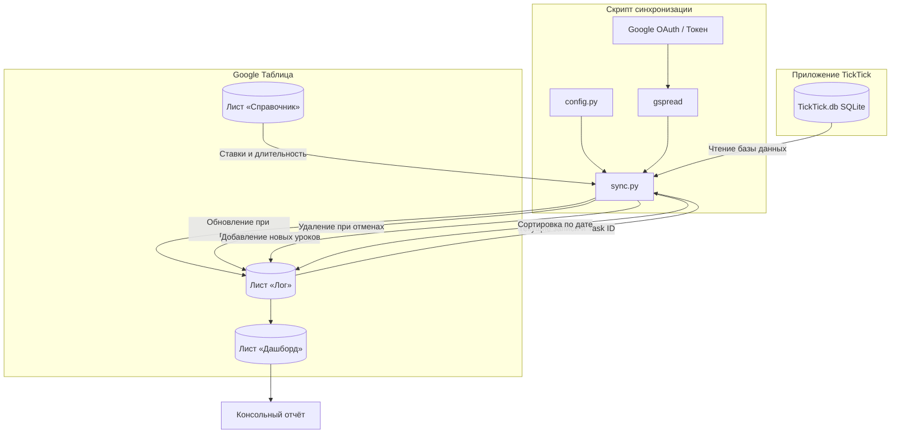

# Синхронизация TickTick с Google Таблицами

[](https://www.python.org/)
[](https://developers.google.com/sheets/api)
[](https://www.sqlite.org/)
[](https://docs.microsoft.com/windows/win32/taskschd/)
[](https://opensource.org/licenses/MIT)

Утилита для автоматической синхронизации проведённых уроков и консультаций из десктопного приложения TickTick в Google Таблицу для учёта выручки и посещаемости.

---

## Зачем это нужно

Если отмечать уроки в TickTick, а финансовый учёт вести в таблицах, переносить каждую запись вручную долго и неудобно. Бесплатные облачные сервисы автоматизации (IFTTT, Zapier) в связке с TickTick работают с задержками до часа, пропускают повторяющиеся задачи и упираются в ежемесячные лимиты.

Скрипт решает эту задачу напрямую: он читает историю задач из локальной базы данных десктопного TickTick (`TickTick.db`) в режиме чтения, сравнивает её со списком в Google Таблице по постоянным идентификаторам (`Task ID`) и выполняет полную сверку:

- **Новые занятия**: добавляются в журнал с датой, именем ученика, фактической длительностью и рассчитанной ставкой.
- **Отмена занятий**: если задача в TickTick была снята с выполнения или удалена, соответствующая строка автоматически удаляется из таблицы.
- **Переносы**: при изменении даты или времени урока в TickTick запись в таблице обновляется на месте.
- **Хронология**: журнал автоматически сортируется по возрастанию даты после любых изменений.
- **Безопасность истории**: строки, внесённые вручную, и занятия прошлых учебных лет защищены от удаления и перезаписи.

---

## Архитектура работы



---

## Структура проекта

```
ticktick-sheets-sync/
├── config/
│   ├── config.yaml            # Локальная конфигурация с личными путями и ID (скрыта в .gitignore)
│   └── config.example.yaml    # Публичный пример конфигурационного файла
├── src/
│   ├── __init__.py
│   ├── config.py              # Загрузка и валидация настроек
│   └── sync.py                # Движок сверки и работа с Google Sheets API
├── tests/
│   ├── __init__.py
│   └── test_suite.py          # Набор из 15 автоматических тестов
├── .gitignore
├── README.md
├── requirements.txt
└── run_sync.bat               # Скрипт запуска для Windows
```

---

## Установка и настройка

### 1. Требования

- Python 3.10 или выше
- Установленное приложение TickTick для Windows или macOS
- Проект в Google Cloud с включённым Google Sheets API и настроенным OAuth-доступом

### 2. Установка

Клонируйте репозиторий и установите зависимости:

```bash
git clone https://github.com/Alexander8841/ticktick-sheets-sync.git
cd ticktick-sheets-sync
pip install -r requirements.txt
```

### 3. Конфигурация

Скопируйте шаблон конфигурации в рабочий файл:

```bash
cp config/config.example.yaml config/config.yaml
```

Заполните параметры в `config/config.yaml`:

```yaml
ticktick:
  # Путь к локальной базе данных TickTick
  db_path: "C:\\Users\\ваше_имя\\AppData\\Roaming\\Tick_Tick\\TickTick.db"
  # ID проекта (списка) в TickTick
  project_id: "ваш_project_id"
  # Дата начала учебного года (задачи до этой даты не затрагиваются)
  academic_year_start: "2026-09-01"
  # Ключевые слова для игнорирования не тарифицируемых задач
  ignore_keywords:
    - "пробн"
    - "trial"

google_sheets:
  # ID таблицы из её URL
  spreadsheet_id: "ваш_spreadsheet_id"
  worksheets:
    log: "Лог"
    dashboard: "Дашборд"
    reference: "Справочник"
  credentials_path: null

defaults:
  known_students:
    - "Ученик 1"
    - "Ученик 2"
  default_durations:
    "Ученик 1": 1.5
    "Ученик 2": 1.0
    "_default": 1.0
```

### 4. Запуск синхронизации

Запуск вручную через Python:

```bash
python src/sync.py
```

В Windows можно дважды кликнуть по файлу `run_sync.bat`.

---

## Автозапуск по расписанию в Windows

Чтобы синхронизация выполнялась автоматически каждый вечер в 22:00 через Планировщик заданий Windows:

```cmd
schtasks /create /tn "SyncTeachingTasks" /tr "\"C:\Users\<Имя_пользователя>\MyFiles\DS_Projects\ticktick-sheets-sync\run_sync.bat\" --no-pause" /sc daily /st 22:00 /f
```

---

## Тестирование

Запуск полного набора автотестов:

```bash
python tests/test_suite.py
```

Тесты проверяют:
- Чтение SQLite-базы TickTick в режиме `mode=ro` без блокировки десктопного приложения.
- Корректность парсинга конфигурации и обработки ошибок при отсутствии файлов.
- Целостность формул на листах Google Таблицы (проверка на отсутствие `#REF!`, `#VALUE!`, `#NAME?`).
- Жизненный цикл сверки на изолированном тестовом листе (добавление, удаление при отмене, обновление при переносе, авторасширение границ сетки).
- Повторные попытки с экспоненциальной задержкой при исчерпании лимитов запросов Google API (ошибка 429).
- Защиту исторических строк и записей ручного ввода от удаления.
- Запуск bat-скриптов без синтаксических ошибок.

---

## Лицензия

Проект распространяется под лицензией MIT. Подробности в файле `LICENSE`.
