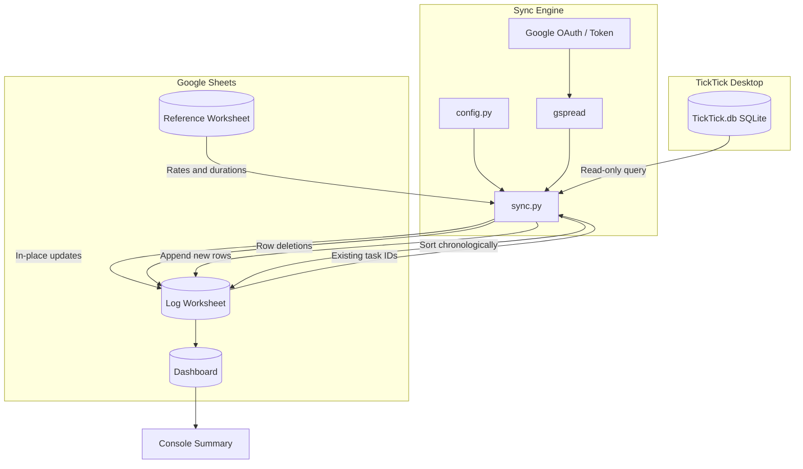

# TickTick to Google Sheets Sync

[](https://www.python.org/)
[](https://developers.google.com/sheets/api)
[](https://www.sqlite.org/)
[](https://docs.microsoft.com/windows/win32/taskschd/)
[](https://opensource.org/licenses/MIT)

Synchronizes completed lessons or billable tasks from the TickTick desktop app to Google Sheets for revenue calculation and attendance tracking.

[English](#overview) | [Русский](#обзор-проекта)

---

## Overview

If you track tutoring sessions or consulting calls in TickTick and maintain billing spreadsheets in Google Sheets, copying completed tasks manually is repetitive and easy to forget. Free cloud automation tools like IFTTT or Zapier often poll infrequently, drop recurring tasks, or run into monthly operation caps.

This utility reads task history directly from the local TickTick desktop SQLite database (`TickTick.db`) in read-only mode, compares it against the Google Sheets log using persistent task IDs, and reconciles the differences:

- **New sessions**: added with lesson date, student name, duration, and calculated fee.
- **Unchecked tasks**: if a completed task is unchecked or deleted in TickTick, the corresponding row is removed from Google Sheets.
- **Rescheduled sessions**: date and duration changes in TickTick update the existing row in place.
- **Sorting**: the sheet is re-sorted chronologically after changes.
- **Safe data handling**: manual entries and historical sessions from prior academic years are left intact.

---

## Architecture



---

## Repository Structure

```
ticktick-sheets-sync/
├── config/
│   ├── config.yaml            # Local configuration with private paths and IDs (gitignored)
│   └── config.example.yaml    # Template configuration file
├── src/
│   ├── __init__.py
│   ├── config.py              # Configuration loader
│   └── sync.py                # Main reconciliation engine
├── tests/
│   ├── __init__.py
│   └── test_suite.py          # Automated test suite
├── .gitignore
├── README.md
├── requirements.txt
└── run_sync.bat               # Windows batch launcher
```

---

## Setup and Usage

### 1. Requirements

- Python 3.10 or higher
- TickTick desktop client for Windows or macOS
- Google Cloud project with the Google Sheets API enabled and OAuth credentials configured

### 2. Installation

Clone the repository and install dependencies:

```bash
git clone https://github.com/Alexander8841/ticktick-sheets-sync.git
cd ticktick-sheets-sync
pip install -r requirements.txt
```

### 3. Configuration

Copy `config/config.example.yaml` to `config/config.yaml`:

```bash
cp config/config.example.yaml config/config.yaml
```

Update the values in `config/config.yaml`:

```yaml
ticktick:
  db_path: "C:\\Users\\your_username\\AppData\\Roaming\\Tick_Tick\\TickTick.db"
  project_id: "your_project_id_here"
  academic_year_start: "2026-09-01"
  ignore_keywords:
    - "пробн"
    - "trial"

google_sheets:
  spreadsheet_id: "your_spreadsheet_id_here"
  worksheets:
    log: "Лог"
    dashboard: "Дашборд"
    reference: "Справочник"
  credentials_path: null

defaults:
  known_students:
    - "Student 1"
    - "Student 2"
  default_durations:
    "Student 1": 1.5
    "Student 2": 1.0
    "_default": 1.0
```

### 4. Running the Sync

Run directly:

```bash
python src/sync.py
```

On Windows, you can also run `run_sync.bat`.

---

## Automated Scheduling on Windows

To run the sync automatically every night at 22:00 via Windows Task Scheduler:

```cmd
schtasks /create /tn "SyncTeachingTasks" /tr "\"C:\Users\<Username>\MyFiles\DS_Projects\ticktick-sheets-sync\run_sync.bat\" --no-pause" /sc daily /st 22:00 /f
```

---

## Testing

Run the test suite:

```bash
python tests/test_suite.py
```

Tests cover:
- Read-only querying of TickTick SQLite tables
- Configuration parsing and path resolution
- Google Sheets formula validation (checks for `#REF!`, `#VALUE!`, `#NAME?`)
- Full reconciliation lifecycle on an isolated test sheet (additions, deletions, in-place updates, out-of-order sorting)
- Rate-limiting retry handling
- Preservation of manual entries and historical records
- Batch file execution without syntax errors

---

<a name="обзор-проекта"></a>
## Обзор проекта (на русском)

Скрипт синхронизирует проведённые уроки или оплачиваемые консультации из десктопного приложения TickTick в Google Таблицу для учёта выручки и посещаемости.

### Зачем это нужно

Если отмечать уроки в TickTick, а бухгалтерию вести в Google Таблицах, переносить каждую запись вручную неудобно. Бесплатные сервисы вроде IFTTT или Zapier в связке с TickTick работают нестабильно: опрашивают задачи с задержкой до часа, пропускают повторяющиеся события и ограничены лимитами запусков.

Этот скрипт подключается напрямую к локальной базе данных десктопного TickTick (`TickTick.db`) в режиме чтения, сверяет выполненные задачи со списком в Google Таблице по уникальным `Task ID` и вносит изменения:

- Добавляет новые проведённые занятия с датой, учеником, длительностью и суммой.
- Удаляет запись из таблицы, если галочка с задачи в TickTick была снята или урок отменился.
- Обновляет дату и время, если урок перенесли на другой день.
- Сортирует журнал по хронологии.
- Не трогает строки, добавленные вручную, и записи за прошлые учебные годы.

---

## License

MIT License. See `LICENSE` for details.
